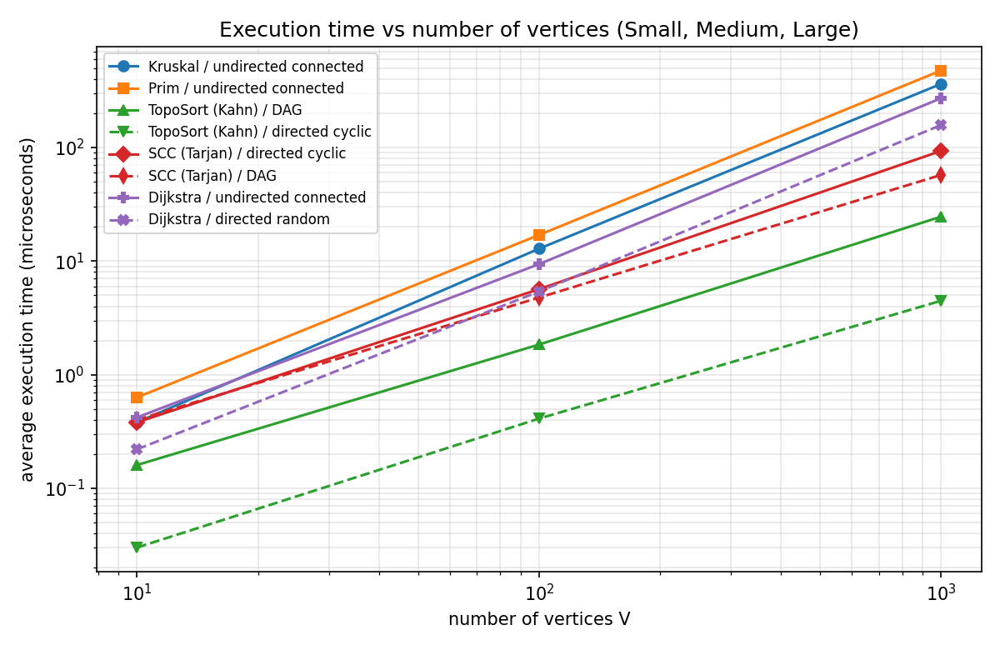
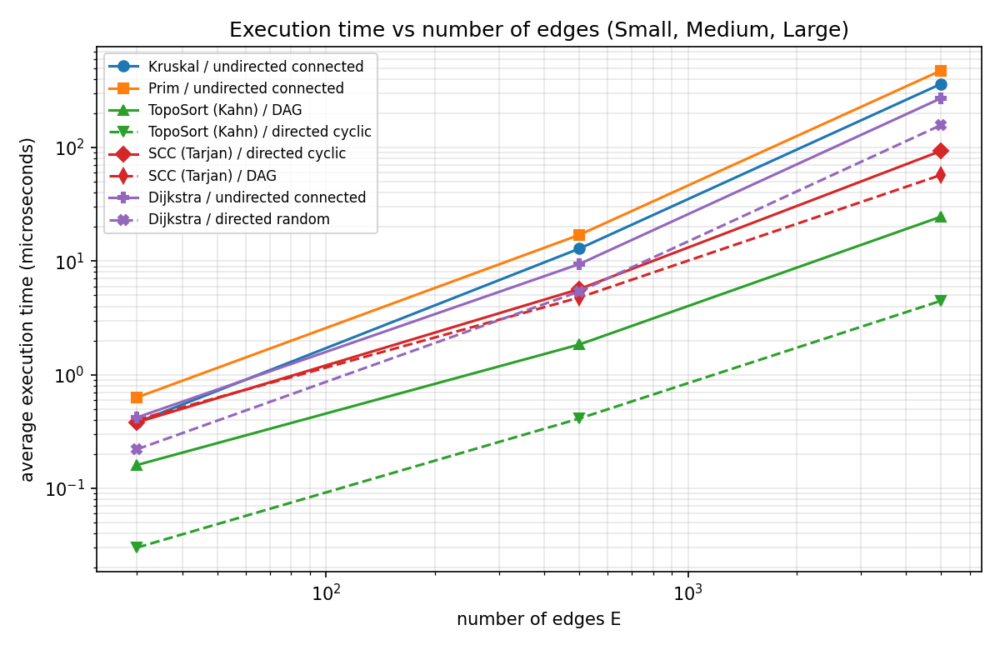
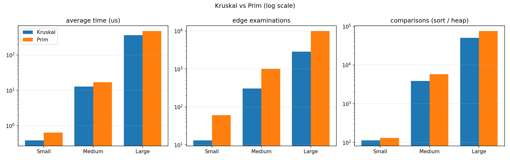
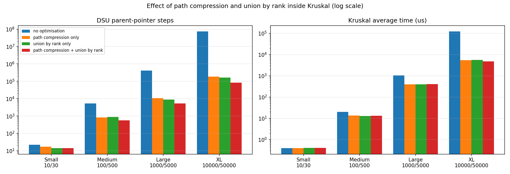

# Assignment 3 — Smart City Infrastructure and Route Planning

**Name:** Khanzada Nyshanbek Adylqyzy · **Group:** SE-2539 · **Language:** Java

## 1. Overview
A smart city is modelled as a graph: districts are vertices, roads are weighted edges (weight = cost or distance), one-way roads and service dependencies are directed edges. The program solves three tasks:
- **Infrastructure planning:** cheapest network that connects all districts (MST with Kruskal and Prim, using DSU).
- **Connectivity analysis:** order of dependent services (topological sort) and groups of locations that can reach each other (SCC).
- **Route planning:** shortest routes from one district to all others (Dijkstra).

**Graph representation:** adjacency list plus a list of all edges. Memory is O(V + E), going through the neighbours of a vertex costs O(degree), and it suits sparse graphs (E ≈ 3V–5V). An adjacency matrix would need O(V²) memory.

## 2. Implementation
| Part | What it does |
|---|---|
| `graph` | `Graph` (adjacency list), `Edge`, `GraphGenerator` (random graphs with a fixed seed) |
| `dsu` | `DSU` with `find` (path compression) and `union` (union by rank). Both optimisations can be switched off to measure their effect |
| `mst` | `Kruskal` (sort edges + DSU), `Prim` (priority queue). Both return the total weight and whether the graph is connected (a disconnected graph gives a spanning forest) |
| `connectivity` | `TopologicalSort` (Kahn, detects cycles), `SCC` (Tarjan, written without recursion, so deep graphs do not overflow the stack) |
| `shortestpath` | `Dijkstra` (binary heap). Gives distances and paths, unreachable vertices keep an infinite distance and an empty path, negative weights are rejected |
| `experiments` | `Benchmark` runs all experiments and writes the tables to `results/tables` |
| `tests`, `app` | `AllTests` (60 checks), `CityDemo` (small example city) |

Every algorithm counts its own operations (edges examined, comparisons, DSU find/union calls, parent steps, heap pushes/pops, relaxations), so the results do not depend only on time.

## 3. Complexity Analysis
Assumptions: adjacency lists, binary heap, E ≤ V² (so log E = O(log V)), α = inverse Ackermann function (at most 4 in practice).
| Algorithm | Time | Extra space | How V and E affect it |
|---|---|---|---|
| DSU find / union | O(α(n)) amortised | O(n) | almost constant per operation |
| Kruskal | O(E log E) = O(E log V) | O(V + E) | sorting the E edges dominates |
| Prim (heap) | O(E log V) | O(V + E) | every edge enters the heap once, so cost grows with E |
| Topological sort (Kahn) | O(V + E) | O(V) | every vertex and edge is processed once |
| SCC (Tarjan) | O(V + E) | O(V) | one DFS |
| Dijkstra (heap) | O((V + E) log V) | O(V + E) | E edge scans, heap work depends on distance updates |

**Why Dijkstra fails with negative weights.** Dijkstra fixes a vertex's distance when it leaves the heap, because it assumes no later path can be shorter. A negative edge breaks this. Example: 0→1 (2), 0→2 (5), 2→1 (−4). Dijkstra fixes vertex 1 at distance 2, but the path 0→2→1 costs 1. A test shows exactly this. For negative weights Bellman-Ford is needed.

## 4. Experimental Setup
- **Sizes:** Small V=10, E=30; Medium V=100, E=500; Large V=1000, E=5000. Extra experiments: V from 250 to 16000 with E = 5V, and V = 1000 with E from 1000 to 100000.
- **Graphs (fixed seed 42, weights 1–100, no self-loops, no duplicate edges):** undirected connected graph = random spanning tree plus random extra edges (always connected); directed graph with cycles = random distinct directed edges (the benchmark confirms that it has cycles); DAG = all edges go from an earlier to a later vertex in a hidden random order (no cycles).
- **Measurement:** graphs are generated before timing. Warm-up runs (so the JVM compiles the code), then 5 repetitions with `System.nanoTime()`, each repetition is a short batch divided by its size. The result is the average of the 5 repetitions, in microseconds (µs). Operation counts are exact.
- **Machine:** MacBook Air (Apple M4, 2025), 16 GB RAM, macOS 15.5, OpenJDK 25.0.1 (Temurin). Absolute times depend on the machine, operation counts do not.

## 5. Results
Average time per run in µs (all graphs in `results/tables/`):
| Algorithm / graph | Small | Medium | Large |
|---|---:|---:|---:|
| Kruskal | 0.38 | 12.85 | 363.05 |
| Prim | 0.63 | 16.98 | 476.40 |
| Topological sort, DAG | 0.16 | 1.84 | 24.60 |
| Topological sort, with cycles | 0.03 | 0.41 | 4.47 |
| SCC, with cycles | 0.38 | 5.66 | 93.31 |
| SCC, DAG | 0.40 | 4.77 | 57.31 |
| Dijkstra, undirected | 0.42 | 9.40 | 271.51 |
| Dijkstra, directed | 0.22 | 5.39 | 157.66 |

**Kruskal vs Prim** (same MST weight in both: 102, 1210, 12120):
| Graph | Algorithm | Edges examined | Comparisons | Other counts |
|---|---|---|---|---|
| Small | Kruskal | 13 | 112 | 26 find, 13 union |
| Small | Prim | 60 | 130 | 30 pushes, 13 pops |
| Medium | Kruskal | 305 | 3841 | 610 find, 305 union |
| Medium | Prim | 1000 | 5734 | 500 pushes, 305 pops |
| Large | Kruskal | 2868 | 50421 | 5736 find, 2868 union |
| Large | Prim | 10000 | 75048 | 5000 pushes, 2886 pops |

**DSU with and without optimisations** (inside Kruskal, parent steps / time):
| Graph | No optimisation | Path compression | Union by rank | Both |
|---|---:|---:|---:|---:|
| Large (1000 / 5000) | 417,495 / 1049 µs | 10,721 / 394 µs | 8,846 / 394 µs | 5,240 / 406 µs |
| XL (10000 / 50000) | 74,609,999 / 124.5 ms | 186,955 / 5.4 ms | 160,684 / 5.6 ms | 82,789 / 4.8 ms |

**Topological sort and SCC:**
| Graph | Topological sort on cyclic graph | SCC on cyclic graph |
|---|---|---|
| Small | cycle detected, 0 of 10 vertices ordered | 1 SCC (size 10) |
| Medium | cycle detected, 0 of 100 ordered | 3 SCCs (largest 98) |
| Large | cycle detected, 7 of 1000 ordered | 15 SCCs (largest 986) |

On DAGs, all vertices are ordered (valid order) and every vertex is its own SCC.

**Dijkstra** (Large): 10000 edge examinations, 1977 relaxations and 36441 heap comparisons on the undirected graph; on the directed graph 993 of 1000 vertices are reachable.






In the three required graphs V and E grow together, so the first two plots look alike. The runs with growing V and with growing E alone are in `results/tables/sweep_vertices.csv` and `sweep_edges.csv`; the SCC growth is in `scc_scaling.csv`.

## 6. Comparison and Discussion
- **Kruskal vs Prim.** Both always give the same weight. On sparse graphs Kruskal was faster (1.3–1.6×). With V = 1000 fixed and E ≥ 20,000 Prim was faster; at E = 100,000 Prim took 4.5 ms and Kruskal 8.0 ms. Reason: Kruskal sorts all E edges (about 1.06 million comparisons), Prim does only about 4,400 pops (363 thousand comparisons) because the tree is complete long before the heap is empty.
- **DSU.** Without optimisation the trees become long chains: on the XL graph 74.6 million parent steps against 83 thousand with both optimisations (about 900× fewer), and Kruskal runs about 26× faster. Union by rank keeps trees at height ≤ log₂ n, path compression makes later `find` calls cost one step. Together they give O(α(n)). On the Small graph the difference is negligible.
- **Topological sort.** On cyclic graphs it correctly reports the cycle and is cheaper than on a DAG (4.5 µs against 24.6 µs on Large), because it stops early.
- **SCC.** Random graphs with 3–5 edges per vertex have one giant SCC (986 of 1000 vertices). Edge examinations equal E and vertex visits equal V, so the work is exactly linear. When V grows 64× (250 → 16000) the time grows 263×, so the time per unit of V + E grows about 4×. A likely reason is memory effects (many small objects, cache misses), but this was not measured separately.
- **Dijkstra.** Edge examinations are exactly 2E on undirected graphs. When E grows 100× (V = 1000), time grows only 37×, because heap work depends on the number of successful relaxations (1,000 → 4,183), not on E. Unreachable vertices are never expanded (V = 1000, E = 1000 reaches only 16 vertices and takes 0.89 µs).
- **Theory vs experiment.** Operation counts follow the formulas. Times follow the same shapes but grow faster than the formulas when V grows (for example Kruskal ×163 against ≈ 100× predicted). For the Small graph the times are close to the timer resolution and should be read only as orders of magnitude.

## 7. Testing
`tests.AllTests` runs 60 checks without external libraries: **Passed: 60, Failed: 0**.
| Required case | Covered by |
|---|---|
| Small graphs | hand-checked MST (weight 16), classic DAG, classic SCC graph, Dijkstra graph with known distances and path |
| Disconnected graphs | both MST algorithms report `connected = false` and the same forest weight; 100 random sparse graphs |
| Graphs with cycles | 3-cycle, self-loop, cycle inside a larger graph; topological sort fails exactly when SCC finds a component with more than one vertex (100 random graphs) |
| Multiple MSTs / duplicate weights | complete graph K4 with equal weights; 150 random graphs with weights 1–3 |
| Unreachable vertices | Dijkstra returns infinite distance and an empty path |
| Single vertex | MST weight 0, topological order [0], one SCC, Dijkstra distance 0 |

Correctness checks: Kruskal = Prim on 300 random graphs (the trees are valid spanning trees); topological order checked by a validator on 200 random DAGs; every vertex is in exactly one SCC, and SCCs equal mutual reachability computed by Floyd–Warshall (200 graphs); Dijkstra equals Bellman-Ford on 150 random graphs; negative weights are rejected, and a test shows the wrong answer Dijkstra gives with them (2 instead of 1).

## 8. Conclusion
- **MST:** Kruskal and Prim always agree. Kruskal is better for sparse graphs, Prim for dense ones.
- **DSU:** path compression and union by rank are essential (74.6 M → 83 K parent steps on the XL graph).
- **Connectivity:** Kahn's algorithm orders services and detects cycles, Tarjan's SCC finds groups of mutually reachable locations, both in O(V + E).
- **Shortest paths:** Dijkstra suits non-negative weights (distances, costs). With negative weights use Bellman-Ford.
- Measured operation counts match the theory; times match the shapes, with extra growth on large graphs.

## 9. How to run
Needs JDK 17+ (Python 3 with `matplotlib` only for the plots).
```bash
mkdir -p out && javac -d out $(find src -name "*.java")
java -cp out tests.AllTests                  # tests
java -cp out app.CityDemo                    # demo
java -cp out experiments.Benchmark results   # tables (about a minute)
python3 scripts/plot.py results              # plots
```
`scripts/run_tests.sh` and `scripts/run_benchmark.sh` do the same.
