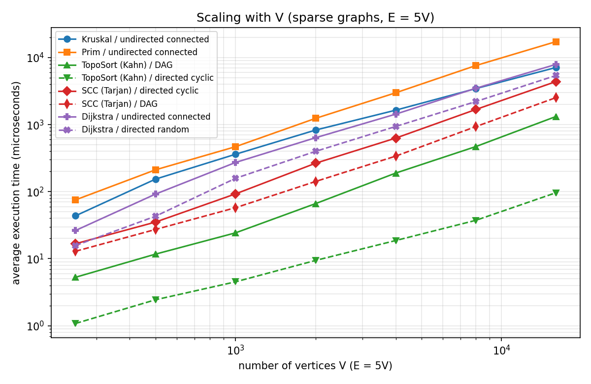
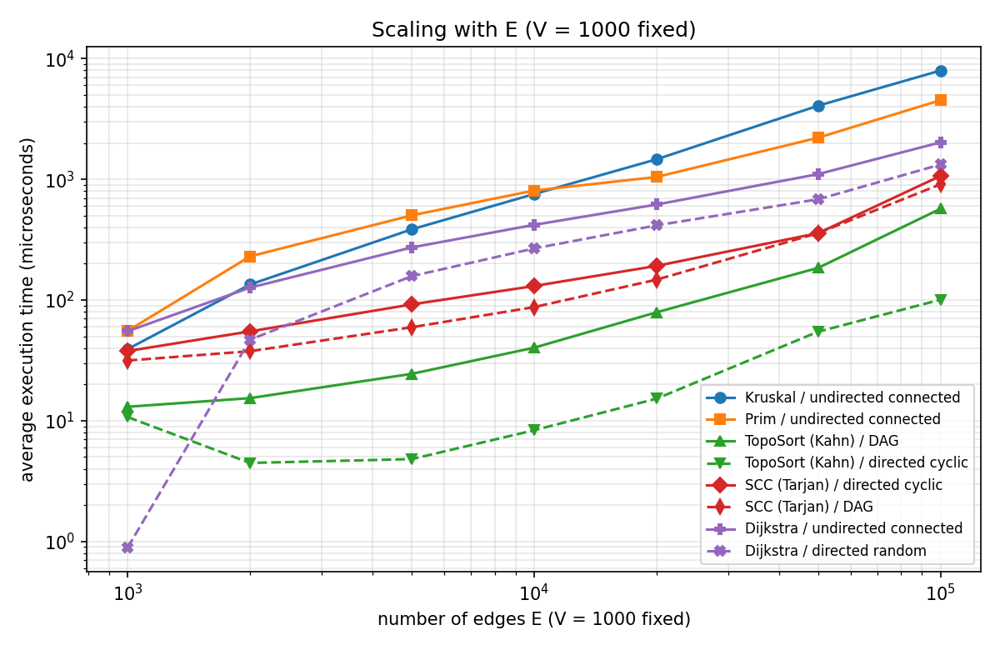
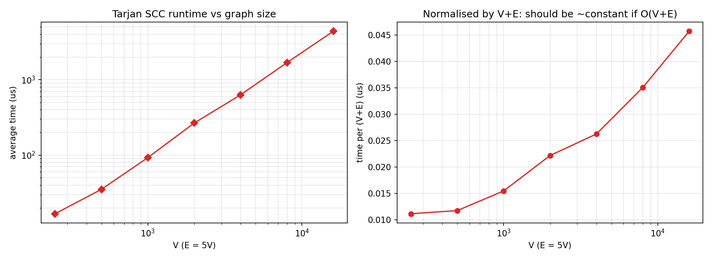
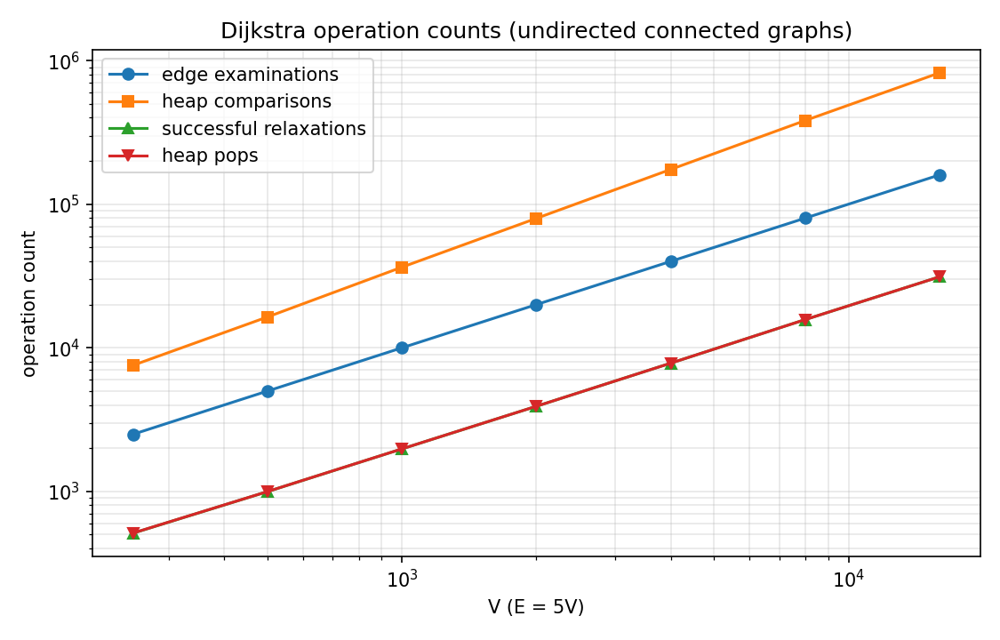

# Assignment 3 — Smart City Infrastructure and Route Planning

Java implementation and experimental analysis of the graph algorithms required by the assignment:
**DSU**, **Kruskal**, **Prim**, **topological ordering (Kahn)**, **strongly connected components (Tarjan)** and **Dijkstra**.
No external libraries are used (the test suite is self-contained, the plots are drawn by a small Python script).

## 1. Overview

A city is modelled as a graph:

| City concept | Graph concept |
|---|---|
| district / location | vertex `0 … V-1` |
| road or infrastructure link | edge |
| construction cost or travel distance | integer edge weight (1–100 in the experiments) |
| one-way road / service dependency | directed edge |

The application supports the three planning tasks of the assignment:

1. **Infrastructure planning** – cheapest network connecting all districts (MST with Kruskal + DSU and Prim + priority queue), including detection of a disconnected city.
2. **Connectivity analysis** – a valid start-up/dependency order if the dependency graph is a DAG (topological ordering, cycle detection) and the groups of mutually reachable locations (SCC).
3. **Route planning** – shortest distances and routes from one district to all others (Dijkstra), with unreachable districts handled explicitly.

**Graph representation.** `graph.Graph` stores an **adjacency list** (`List<List<Edge>>`, outgoing edges per vertex) plus a flat **edge list**.
Directed edges appear once in the adjacency list; an undirected edge appears once in the edge list and in the adjacency lists of both endpoints.
Space is `O(V + E)`, iterating over the neighbours of `v` costs `O(deg(v))`, and the flat edge list is what Kruskal sorts.
A matrix would need `O(V²)` memory, which is wasteful for the sparse graphs of the assignment (E ≈ 3V–5V).

`app.CityDemo` shows all algorithms on a hand-made 8-district city (`java -cp out app.CityDemo`):

```text
=== 1. Infrastructure planning: cheapest network connecting all districts (MST) ===
Kruskal: total cost 39, connected = true
   build University <-> Tech Park  (cost 2)
   build Harbor <-> Riverside  (cost 3)
   build Central <-> Old Town  (cost 4)
   build Old Town <-> Riverside  (cost 5)
   build Central <-> University  (cost 7)
   build Tech Park <-> Stadium  (cost 8)
   build Stadium <-> Airport  (cost 10)
Prim:    total cost 39  -> same cost: true

=== 2. One-way roads: strongly connected components ===
Number of SCCs: 5
   {Airport}
   {Central, Harbor, Old Town}
   {Riverside}
   {Stadium}
   {University, Tech Park}
Topological order of the whole road map possible? false

=== 3. Service dependencies: topological ordering ===
Is DAG: true
Start-up order: Power grid -> Water pumps -> Traffic lights -> Control center -> Public transport -> Emergency dispatch
After adding dispatch -> power: is DAG = false (6 services can no longer be ordered: they are on or behind the cycle)

=== 4. Route planning: Dijkstra from Central (distances in km) ===
   Central              0 km   route: Central
   Harbor              10 km   route: Central -> Old Town -> Harbor
   Airport             22 km   route: Central -> Old Town -> Harbor -> Airport
   University           7 km   route: Central -> University
   Old Town             4 km   route: Central -> Old Town
   Tech Park            9 km   route: Central -> Tech Park
   Stadium             17 km   route: Central -> Tech Park -> Stadium
   Riverside            9 km   route: Central -> Old Town -> Riverside
   Remote Village (not connected) unreachable
```

## 2. Implementation

```
assignment-3/
├── src/
│   ├── graph/          Edge, Graph (adjacency list), GraphGenerator (seeded random graphs)
│   ├── dsu/            DSU (find/union, switchable path compression and union by rank)
│   ├── mst/            Kruskal, Prim, MSTResult
│   ├── connectivity/   TopologicalSort (Kahn), SCC (Tarjan, iterative)
│   ├── shortestpath/   Dijkstra, DijkstraResult
│   ├── experiments/    Benchmark (all experiments -> CSV/Markdown tables)
│   ├── app/            CityDemo (readable smart-city scenario)
│   └── tests/          AllTests (60 self-contained checks)
├── results/
│   ├── tables/         *.csv and *.md produced by the benchmark
│   └── plots/          *.png produced by scripts/plot.py
├── scripts/            run_tests.sh, run_benchmark.sh, plot.py
└── README.md
```

Main design decisions:

* **DSU** (`dsu.DSU`) – array-based `parent[]` / `rank[]`. `find` is *iterative* (no recursion depth problem) and does path compression in a second pass; `union` links the root of the lower rank under the root of the higher rank. Both optimisations can be switched off through the constructor, which is how the ablation experiment in section 5.2 measures what each one buys. The DSU counts `find` calls, `union` calls and *parent steps* (pointer hops), the real cost of a find.
* **Kruskal** (`mst.Kruskal`) – copies the edge list, sorts it with a comparator that counts comparisons (stable sort, so equal weights keep input order and results are deterministic), then scans it with the DSU. It **stops as soon as V-1 edges are accepted**. On a disconnected graph it returns a *minimum spanning forest* and `isConnected()` is `false`.
* **Prim** (`mst.Prim`) – lazy Prim with `java.util.PriorityQueue<Edge>`: when a vertex joins the tree, all edges to vertices *outside* the tree are pushed; the cheapest edge is popped, and stale edges (both ends already in the tree) are skipped. It is restarted from every unvisited vertex, so disconnected graphs give a spanning forest and the component count, exactly like Kruskal. This makes the *connectivity detection* identical in both algorithms (`components == 1`), and the *weights are comparable even for disconnected graphs*.
* **Topological ordering** (`connectivity.TopologicalSort`) – Kahn's algorithm. If fewer than V vertices can be removed, the graph contains a cycle: the result says `isDag == false` and how many vertices could not be ordered (they lie on a cycle or are reachable from one). `isValidOrder` is an independent checker used by tests and by the benchmark.
* **SCC** (`connectivity.SCC`) – Tarjan's algorithm instead of Kosaraju: one DFS pass, no reversed graph needed. The DFS is implemented with an explicit stack, so a 200,000-vertex path graph does not overflow the Java call stack (this is covered by a test). `SCC.condensation` builds the DAG of components.
* **Dijkstra** (`shortestpath.Dijkstra`) – binary heap (`PriorityQueue`) with *lazy deletion* (stale entries are skipped through a `done[]` array). Distances are `long`, unreachable vertices keep `INF = Long.MAX_VALUE`, parents allow path reconstruction (`pathTo(v)` returns an empty list for unreachable vertices). `run` **throws `IllegalArgumentException` if any edge weight is negative** (the graph tracks this flag in O(1)).
* **Counters, not guesses** – every algorithm records the operations that the assignment asks for. Definitions:

| Counter | Meaning |
|---|---|
| edge examinations (Kruskal) | edges taken from the sorted list |
| edge examinations (Prim, Dijkstra, SCC, Kahn) | adjacency-list entries scanned (Kahn also counts the in-degree pass over all edges) |
| comparisons | calls of the comparator (sort in Kruskal, heap in Prim and Dijkstra) |
| DSU find / union calls | every `union` makes two `find` calls, which are included in the find count |
| DSU parent steps | pointer hops while walking to a root |
| PQ pushes / pops | heap insertions / removals (pops include stale entries) |
| relaxations (Dijkstra) | successful distance improvements |

## 3. Complexity Analysis

Assumptions: graphs are stored as adjacency lists (plus an edge list for Kruskal); the priority queue is a **binary heap** (`PriorityQueue`); `V` vertices, `E` edges; since `E ≤ V²`, `log E = O(log V)`; α is the inverse Ackermann function (α(n) ≤ 4 for any realistic n).

| Algorithm | Time | Extra space | How V and E influence it |
|---|---|---|---|
| **DSU `find`/`union`** (path compression + union by rank) | amortised **O(α(n))** per operation; m operations on n elements: O(m·α(n)) | O(n) (`parent`, `rank`) | Practically constant per operation, independent of how large the set is. Without optimisations a `find` can cost O(n) (a chain); with union by rank only O(log n); with path compression only amortised O(log n). |
| **Kruskal** | **O(E log E + E·α(V)) = O(E log V)** – sorting dominates | O(V + E) (sorted edge copy + DSU) | Cost is driven by **E** (the sort). V enters only through the DSU (almost constant) and the log. |
| **Prim** (lazy, binary heap) | **O(E log E) = O(E log V)** | O(V + E) (heap can hold up to E edges) | Every edge is pushed once and scanned twice (2E scans). The log factor depends on the heap size. A version with an indexed heap (decrease-key) reaches O(E log V) with O(V) heap memory; an adjacency-matrix version is O(V²), which is better only for very dense graphs. |
| **Topological ordering** (Kahn) | **O(V + E)** | O(V) | Every vertex enters the queue once and every edge is relaxed once; linear in the size of the graph. |
| **SCC** (Tarjan) | **O(V + E)** | O(V) (index, low-link, two stacks) | One DFS: every vertex is visited once and every edge examined once. |
| **Dijkstra** (binary heap, lazy deletion) | **O((V + E) log V)**; O(E log V) when most vertices are reachable | O(V + E) (heap holds ≤ E+1 entries) | **E** drives the number of edge scans; the heap work is driven by the number of *successful relaxations*, which is at most E but usually far less (see section 6.4). With an array instead of a heap: O(V²), better only for dense graphs. |

**Why Dijkstra is unsuitable for graphs with negative edge weights.** Dijkstra finalises a vertex the moment it is removed from the heap, because with non-negative weights no later path can be shorter (every further edge adds ≥ 0). A negative edge breaks this argument: a longer-looking path can become shorter later. Example (verified by a test): edges `0→1 (2)`, `0→2 (5)`, `2→1 (-4)`. Dijkstra finalises vertex 1 with distance 2 (it is cheaper than 5), and never revisits it, but the real shortest path is `0→2→1` with length `5 − 4 = 1`. A negative *cycle* makes shortest paths undefined altogether. For such graphs Bellman-Ford (O(V·E)) is used instead. That is why `Dijkstra.run` rejects negative weights; `runUnchecked` exists only to demonstrate the wrong answer in the tests.

## 4. Experimental Setup

**Graph sizes** (as required): Small V=10, E=30 · Medium V=100, E=500 · Large V=1,000, E=5,000.

**Graph generation** (`graph.GraphGenerator`, `java.util.Random` with a fixed seed; no self-loops, no duplicate edges; integer weights uniform in [1, 100]). The seed of each graph is `42 + type·1,000,003 + V·10,007 + E` with `type` = 0 (undirected), 1 (directed), 2 (DAG), so every graph is reproducible and different graph types are independent.

| Graph type | Used for | How it is generated | Cycles? |
|---|---|---|---|
| **Undirected, connected** | Kruskal, Prim, DSU, Dijkstra | A random spanning tree first (each vertex of a random permutation is attached to a random earlier vertex → connected for sure), then random extra edges until exactly E edges exist. | – |
| **Directed, random ("cyclic")** | SCC, topological sort (cycle case), Dijkstra | E distinct random ordered pairs (u→v), u≠v. | **Yes.** Verified by the benchmark: topological sort fails and SCC finds a component with more than one vertex (largest SCC: 10 / 98 / 986 vertices for Small / Medium / Large). |
| **Directed acyclic (DAG)** | topological sort (DAG case), SCC | A random permutation defines a hidden order; every edge is oriented from the earlier to the later vertex. | **No** (by construction; every output is also checked with `isValidOrder`). |

**Additional experiments beyond the three required sizes** (same generators):

* *Vertex sweep*: E = 5V, V ∈ {250, 500, 1000, 2000, 4000, 8000, 16000}. This shows scaling with V (needed for the SCC scaling analysis).
* *Edge sweep*: V = 1,000 fixed, E ∈ {1000, 2000, 5000, 10000, 20000, 50000, 100000}. This separates the influence of E from that of V. (With only the three required sizes, V and E grow together and cannot be told apart.)
* *DSU ablation*: Kruskal with 4 DSU variants on Small, Medium, Large and an extra XL graph (V=10,000, E=50,000), plus a micro-benchmark on a chain of 10,000 elements.

**Measurement procedure** (`experiments.Benchmark.measure`):

1. Graph generation is **outside** the timed region.
2. JIT warm-up: a global warm-up, then for every measurement at least 20 runs and at least 100 ms of runs that are discarded.
3. The cost of one run is estimated and a batch size is chosen so that one repetition lasts about 10 ms (algorithms on the Small graph finish in well under a microsecond, which a single `System.nanoTime()` pair cannot resolve).
4. `System.gc()`, then **5 repetitions**; each repetition is timed with `System.nanoTime()` and divided by its batch size. **The reported time is the average of the 5 repetitions** (time of one run, in microseconds, µs).
5. Operation counts are deterministic (same graph, same algorithm), so they are taken from the last run.
6. Dijkstra always starts from vertex 0. Kruskal and Prim are compared on the same graph, and the benchmark throws an exception if their MST weights ever differ.

Environment of the reported numbers: OpenJDK 64-Bit Server VM 21, Linux container, single process. **Absolute times depend on the machine; the shapes of the curves and the operation counts do not.** Run-to-run variation of the same measurement was observed to be a few percent up to about 10–15 %; for the Small graph (0.03–0.6 µs) the numbers are close to what `System.nanoTime()` can resolve and should only be read as orders of magnitude.

## 5. Results

All tables are produced by `experiments.Benchmark` (CSV and Markdown versions in `results/tables/`); all times are **average µs per run**.

### 5.1 Average execution time, all algorithms (required sizes)

| Algorithm / graph | Small (V=10, E=30) | Medium (V=100, E=500) | Large (V=1000, E=5000) |
|---|---|---|---|
| Kruskal / undirected connected | 0.38 | 12.85 | 363.05 |
| Prim / undirected connected | 0.63 | 16.98 | 476.40 |
| TopoSort (Kahn) / DAG | 0.16 | 1.84 | 24.60 |
| TopoSort (Kahn) / directed cyclic | 0.03 | 0.41 | 4.47 |
| SCC (Tarjan) / directed cyclic | 0.38 | 5.66 | 93.31 |
| SCC (Tarjan) / DAG | 0.40 | 4.77 | 57.31 |
| Dijkstra / undirected connected | 0.42 | 9.40 | 271.51 |
| Dijkstra / directed random | 0.22 | 5.39 | 157.66 |


*(In the three required graphs V and E grow together, so the two plots have the same shape. The sweeps below separate the two.)*



| Algorithm / graph | V=250 | V=500 | V=1000 | V=2000 | V=4000 | V=8000 | V=16000 |
|---|---|---|---|---|---|---|---|
| Kruskal / undirected connected | 43.60 | 153.92 | 361.96 | 830.74 | 1644.28 | 3450.05 | 7115.75 |
| Prim / undirected connected | 75.34 | 211.87 | 469.17 | 1242.26 | 2988.58 | 7609.58 | 17300.28 |
| TopoSort (Kahn) / DAG | 5.28 | 11.70 | 24.32 | 66.42 | 189.51 | 470.80 | 1321.23 |
| TopoSort (Kahn) / directed cyclic | 1.08 | 2.44 | 4.52 | 9.43 | 18.67 | 37.36 | 96.35 |
| SCC (Tarjan) / directed cyclic | 16.71 | 35.19 | 92.73 | 265.98 | 629.92 | 1682.85 | 4389.28 |
| SCC (Tarjan) / DAG | 12.90 | 27.31 | 57.70 | 142.09 | 339.30 | 935.17 | 2527.58 |
| Dijkstra / undirected connected | 26.32 | 92.03 | 272.90 | 638.69 | 1435.13 | 3488.93 | 7921.57 |
| Dijkstra / directed random | 15.72 | 43.03 | 158.37 | 399.93 | 939.88 | 2209.55 | 5406.96 |



| Algorithm / graph | E=1000 | E=2000 | E=5000 | E=10000 | E=20000 | E=50000 | E=100000 |
|---|---|---|---|---|---|---|---|
| Kruskal / undirected connected | 39.22 | 134.41 | 385.20 | 754.73 | 1463.90 | 4073.28 | 7964.37 |
| Prim / undirected connected | 55.51 | 230.02 | 502.64 | 807.32 | 1044.68 | 2212.53 | 4522.59 |
| TopoSort (Kahn) / DAG | 13.05 | 15.39 | 24.46 | 40.27 | 79.07 | 184.69 | 570.74 |
| TopoSort (Kahn) / directed cyclic | 10.72 | 4.47 | 4.81 | 8.34 | 15.23 | 54.70 | 100.64 |
| SCC (Tarjan) / directed cyclic | 37.79 | 54.97 | 91.97 | 130.57 | 191.61 | 358.23 | 1067.23 |
| SCC (Tarjan) / DAG | 31.53 | 37.66 | 59.48 | 87.36 | 147.40 | 358.23 | 909.80 |
| Dijkstra / undirected connected | 55.16 | 126.65 | 272.64 | 419.54 | 617.61 | 1104.14 | 2024.28 |
| Dijkstra / directed random | 0.89 | 46.96 | 157.70 | 267.45 | 415.33 | 683.06 | 1326.17 |

### 5.2 Task 1 — MST: Kruskal vs Prim, and DSU

**Kruskal vs Prim** (required sizes; both return the same MST weight):

| Graph | V | E | Algorithm | MST weight | Avg time (us) | Edge exams | Comparisons | DSU find calls | DSU union calls | DSU parent steps | PQ pushes | PQ pops |
|---|---|---|---|---|---|---|---|---|---|---|---|---|
| Small | 10 | 30 | Kruskal | 102 | 0.38 | 13 | 112 | 26 | 13 | 14 | - | - |
| Small | 10 | 30 | Prim | 102 | 0.63 | 60 | 130 | - | - | - | 30 | 13 |
| Medium | 100 | 500 | Kruskal | 1210 | 12.85 | 305 | 3841 | 610 | 305 | 557 | - | - |
| Medium | 100 | 500 | Prim | 1210 | 16.98 | 1000 | 5734 | - | - | - | 500 | 305 |
| Large | 1000 | 5000 | Kruskal | 12120 | 363.05 | 2868 | 50421 | 5736 | 2868 | 5240 | - | - |
| Large | 1000 | 5000 | Prim | 12120 | 476.40 | 10000 | 75048 | - | - | - | 5000 | 2886 |


**DSU ablation inside Kruskal** (same graphs and same MST weights; only the DSU optimisations differ):

| Graph | V | E | DSU variant | MST weight | Avg time (us) | DSU find calls | DSU union calls | DSU parent steps |
|---|---|---|---|---|---|---|---|---|
| Small | 10 | 30 | no optimisation | 102 | 0.39 | 26 | 13 | 22 |
| Small | 10 | 30 | path compression only | 102 | 0.39 | 26 | 13 | 17 |
| Small | 10 | 30 | union by rank only | 102 | 0.40 | 26 | 13 | 14 |
| Small | 10 | 30 | path compression + union by rank | 102 | 0.40 | 26 | 13 | 14 |
| Medium | 100 | 500 | no optimisation | 1210 | 20.11 | 610 | 305 | 5270 |
| Medium | 100 | 500 | path compression only | 1210 | 13.55 | 610 | 305 | 840 |
| Medium | 100 | 500 | union by rank only | 1210 | 12.99 | 610 | 305 | 887 |
| Medium | 100 | 500 | path compression + union by rank | 1210 | 13.09 | 610 | 305 | 557 |
| Large | 1000 | 5000 | no optimisation | 12120 | 1048.93 | 5736 | 2868 | 417495 |
| Large | 1000 | 5000 | path compression only | 12120 | 394.03 | 5736 | 2868 | 10721 |
| Large | 1000 | 5000 | union by rank only | 12120 | 393.54 | 5736 | 2868 | 8846 |
| Large | 1000 | 5000 | path compression + union by rank | 12120 | 405.69 | 5736 | 2868 | 5240 |
| XL | 10000 | 50000 | no optimisation | 124784 | 124544.28 | 87582 | 43791 | 74609999 |
| XL | 10000 | 50000 | path compression only | 124784 | 5413.73 | 87582 | 43791 | 186955 |
| XL | 10000 | 50000 | union by rank only | 124784 | 5600.71 | 87582 | 43791 | 160684 |
| XL | 10000 | 50000 | path compression + union by rank | 124784 | 4804.46 | 87582 | 43791 | 82789 |


**DSU worst-case style micro-benchmark** (`union(0,1), union(1,2), …, union(n-2,n-1)`, then `find(i)` for every element, n = 10,000):

| Scenario | DSU variant | Avg time (us) | find calls | union calls | parent steps |
|---|---|---|---|---|---|
| chain n=10000 | no optimisation | 65642.19 | 29998 | 9999 | 49995000 |
| chain n=10000 | path compression only | 62.91 | 29998 | 9999 | 19997 |
| chain n=10000 | union by rank only | 71.44 | 29998 | 9999 | 19997 |
| chain n=10000 | path compression + union by rank | 52.45 | 29998 | 9999 | 19997 |

### 5.3 Task 2 — Topological ordering and SCC

**Topological ordering** on a DAG and on a graph with cycles:

| Graph | V | E | Input type | Result | Vertices ordered | Avg time (us) | Edge exams | Vertices popped |
|---|---|---|---|---|---|---|---|---|
| Small | 10 | 30 | DAG | valid order found | 10 | 0.16 | 60 | 10 |
| Small | 10 | 30 | directed cyclic | cycle detected | 0 | 0.03 | 30 | 0 |
| Medium | 100 | 500 | DAG | valid order found | 100 | 1.84 | 1000 | 100 |
| Medium | 100 | 500 | directed cyclic | cycle detected | 0 | 0.41 | 500 | 0 |
| Large | 1000 | 5000 | DAG | valid order found | 1000 | 24.60 | 10000 | 1000 |
| Large | 1000 | 5000 | directed cyclic | cycle detected | 7 | 4.47 | 5039 | 7 |

**SCC** on the cyclic random digraph and on the DAG:

| Graph | V | E | Input type | #SCCs | Largest SCC | Avg time (us) | Edge exams | Vertex visits |
|---|---|---|---|---|---|---|---|---|
| Small | 10 | 30 | directed cyclic | 1 | 10 | 0.38 | 30 | 10 |
| Small | 10 | 30 | DAG | 10 | 1 | 0.40 | 30 | 10 |
| Medium | 100 | 500 | directed cyclic | 3 | 98 | 5.66 | 500 | 100 |
| Medium | 100 | 500 | DAG | 100 | 1 | 4.77 | 500 | 100 |
| Large | 1000 | 5000 | directed cyclic | 15 | 986 | 93.31 | 5000 | 1000 |
| Large | 1000 | 5000 | DAG | 1000 | 1 | 57.31 | 5000 | 1000 |

**SCC scaling** (E = 5V, vertex sweep; the `us per (V+E)` column is the cost per unit of graph size):

| V | E | Avg time (us) | us per (V+E) | #SCCs | Largest SCC |
|---|---|---|---|---|---|
| 250 | 1250 | 16.71 | 0.0111 | 6 | 245 |
| 500 | 2500 | 35.19 | 0.0117 | 9 | 492 |
| 1000 | 5000 | 92.73 | 0.0155 | 15 | 986 |
| 2000 | 10000 | 265.98 | 0.0222 | 35 | 1966 |
| 4000 | 20000 | 629.92 | 0.0262 | 68 | 3933 |
| 8000 | 40000 | 1682.85 | 0.0351 | 133 | 7868 |
| 16000 | 80000 | 4389.28 | 0.0457 | 222 | 15779 |



### 5.4 Task 3 — Dijkstra

| Graph | V | E | Input type | Reachable from source | Avg time (us) | Edge exams | Relaxations | PQ pushes | PQ pops | Comparisons |
|---|---|---|---|---|---|---|---|---|---|---|
| Small | 10 | 30 | undirected connected | 10/10 | 0.42 | 60 | 14 | 15 | 15 | 64 |
| Small | 10 | 30 | directed random | 10/10 | 0.22 | 30 | 9 | 10 | 10 | 22 |
| Medium | 100 | 500 | undirected connected | 100/100 | 9.40 | 1000 | 214 | 215 | 215 | 2599 |
| Medium | 100 | 500 | directed random | 100/100 | 5.39 | 500 | 145 | 146 | 146 | 1471 |
| Large | 1000 | 5000 | undirected connected | 1000/1000 | 271.51 | 10000 | 1977 | 1978 | 1978 | 36441 |
| Large | 1000 | 5000 | directed random | 993/1000 | 157.66 | 4961 | 1425 | 1426 | 1426 | 23848 |



## 6. Comparison and Discussion

### 6.1 Kruskal vs Prim

* **Correctness:** both algorithms return exactly the same MST weight on every graph (102, 1,210 and 12,120), and the benchmark aborts if they ever disagree.
* **Operation counts differ in kind.** Kruskal examines only 13 / 305 / 2,868 of the 30 / 500 / 5,000 edges, because it stops after V-1 accepted edges, but it pays for sorting *all* edges (112 / 3,841 / 50,421 comparisons). Prim scans every adjacency entry (2E = 60 / 1,000 / 10,000), pushes **every edge exactly once** (30 / 500 / 5,000 pushes, equal to E) and needs more heap comparisons (130 / 5,734 / 75,048) because comparisons occur in sift-up/sift-down operations. Prim's pops (13 / 305 / 2,886) are close to the number of edges Kruskal examines.
* **Time on the required sparse graphs (E ≈ 3V–5V):** Kruskal was faster on all three sizes (0.38 vs 0.63 µs, 12.85 vs 16.98 µs, 363 vs 476 µs; Prim is about 1.3–1.6× slower). The vertex sweep (E = 5V) shows the same picture up to V = 16,000 (7.1 ms vs 17.3 ms).
* **Dense graphs reverse the order.** With V fixed at 1,000, Kruskal and Prim are about equal at E = 10,000 (755 vs 807 µs), and for larger E **Prim wins**: at E = 100,000 Prim needs 4.5 ms and Kruskal 8.0 ms. The counters explain it: Kruskal sorts all E edges (1,060,623 comparisons), while Prim pushes the same 100,000 edges but only needs ~4,400 expensive pops (363,300 comparisons in total), because inserting into a binary heap is cheap on average and the tree is finished long before the heap is empty. So `O(E log V)` is a worst-case bound for both; in practice Kruskal's cost grows like `E log E`, while lazy Prim behaves closer to `E + V log E` on random weights.
* **Other differences:** Kruskal needs an explicit edge list and a sort, and works naturally on edge lists and for forests; Prim only needs adjacency lists and grows one tree, which is convenient when the graph is given as an adjacency structure and is dense.

### 6.2 DSU: why path compression and union by rank matter

* **Without any optimisation the DSU degenerates into long chains.** On the XL graph (V = 10,000, E = 50,000) Kruskal needs **74.6 million** parent steps with a naive DSU, but only 187 k with path compression, 161 k with union by rank and **83 k with both** (≈ 900× fewer). The time follows: 124.5 ms → 5.4 ms / 5.6 ms / 4.8 ms. On the Large graph the steps drop from 417,495 to 5,240 (≈ 80×), and on the Medium graph from 5,270 to 557.
* **Chain micro-benchmark** (n = 10,000): the naive DSU performs 49,995,000 steps (n(n-1)/2, quadratic) and needs 65.6 ms; every optimised variant needs ≈ 20,000 steps (less than one per `find` call on average) and 50–70 µs, **about 1,000× faster**. In this particular union order union by rank already keeps the trees flat, so the three optimised variants coincide; on the random graphs of the ablation table the combination of both optimisations needs the fewest parent steps (or ties for the fewest) in every row.
* **Explanation.** *Union by rank* attaches the shallower tree below the deeper one, so tree height is at most log₂ n. *Path compression* flattens every path that a `find` walks along, so later finds on the same elements cost one step. Together they give the amortised `O(α(n))` bound; separately each gives `O(log n)` amortised.
* On the Small graph (V = 10) the difference is negligible (22 vs 14 steps, equal times): the optimisations matter as the problem grows.

### 6.3 SCC and topological ordering

* **Topological ordering.** On DAGs Kahn's algorithm orders all vertices and the result passes `isValidOrder` (Small/Medium/Large). On the cyclic digraphs it correctly reports a cycle: **0 / 0 / 7 vertices** could be ordered (no vertex of in-degree 0 exists in the Small and Medium graphs, in the Large graph only 7 vertices could be removed before the algorithm stalled). Detecting the cycle is *cheaper* than ordering a DAG (24.6 µs vs 4.5 µs on Large; 5,039 vs 10,000 edge examinations), because the algorithm stops early instead of processing all edges.
* **SCC structure.** The random digraphs with E ≈ 3–5 · V contain one **giant SCC** (10 of 10, 98 of 100, 986 of 1,000 vertices) and a few trivial components (1 / 3 / 15 components); the DAG has exactly V components of size 1, as it must.
* **SCC scaling.** Edge examinations equal E and vertex visits equal V in every row of the SCC table, i.e. the *operation count is exactly linear*, as O(V + E) predicts. Over the vertex sweep (V and E both ×64) the time grows ×263, i.e. the time per unit of V+E rises from 0.011 µs to 0.046 µs (×4). The algorithm is still linear in its operation count, so the extra growth comes from the memory system (the adjacency-list objects no longer fit in the CPU caches and there is more garbage-collection work for larger graphs); this explanation is an interpretation and was not measured separately. On the DAG, SCC is faster than on the cyclic graph (57 vs 93 µs on Large) (presumably because no large component has to be assembled and popped from the Tarjan stack; this was not measured separately).

### 6.4 Dijkstra

* **Operation counts:** edge examinations are exactly **2E** on the undirected connected graphs (60 / 1,000 / 10,000), because every vertex is reachable and every adjacency entry is scanned once. Heap pushes equal relaxations + 1 (the source), and relaxations are only about 2V (1,977 for V = 1,000) rather than E, because most edges do not improve any distance.
* **Time across sizes:** 0.42 → 9.4 → 271.5 µs (undirected) for V = 10 → 100 → 1,000. The directed graph is cheaper (157.7 µs on Large): only E (not 2E) adjacency entries exist, and 7 of the 1,000 vertices are not reachable from the source.
* **Unreachable vertices** are never touched: in the edge sweep with V = 1,000 and E = 1,000 the random digraph reaches only 16 of 1,000 vertices from vertex 0 and Dijkstra needs 0.89 µs, the same call on the undirected connected graph with the same V and E takes 55 µs. The running time depends on the *reachable part* of the graph.
* **E-sweep:** from E = 1,000 to 100,000 the time grows only ×37 although E grows ×100, because the heap work depends on the number of relaxations (1,000 → 4,183), not on E; the extra edges are cheap array scans.

### 6.5 Theory vs experiment

Observed growth of the average time between the smallest and the largest point of each sweep, compared with the growth predicted by the complexity formulas:

| Algorithm | V sweep: V × 64 and E = 5V (V=250 → 16,000) predicted | observed | E sweep: E × 100, V = 1,000 predicted | observed |
|---|---|---|---|---|
| Kruskal | E log E: ≈ 100× | 163× | E log E: ≈ 165× | 203× |
| Prim (lazy) | E log V: ≈ 100× | 230× | E log V: ≈ 100× (upper bound) | 81× |
| Topological ordering (DAG) | V + E: 64× | 250× | V + E: ≈ 50× | 44× |
| SCC (cyclic) | V + E: 64× | 263× | V + E: ≈ 50× | 28× |
| Dijkstra (undirected) | E log V: ≈ 112× | 301× | E log V: 100× (upper bound) | 37× |

* The **shape** agrees with the theory: no algorithm shows quadratic growth (the fitted growth exponents are between 1.15 and 1.37 in the vertex sweep), and when V is fixed the linear algorithms scale *sub*-linearly in E because the fixed V part of the work does not grow.
* In the **vertex sweep** every algorithm grows faster than the formula (by a factor of about 1.6–4). The most likely cause is the memory hierarchy: the graphs consist of many small objects (`Edge`, list nodes), so large graphs lose cache locality and cause more garbage collection; the formulas count operations, not cache misses. This was not tested separately.
* In the **edge sweep** Prim and Dijkstra grow slower than their `O(E log V)` bound, because the heap work is driven by pops and relaxations, which grow far slower than E (section 6.1 and 6.4). The bound remains correct as a worst case.

## 7. Testing

`tests.AllTests` runs **60 checks** without any external library (`scripts/run_tests.sh`, exit code 0 only if all pass). Result: **`Passed: 60   Failed: 0`**.

| Required test case | How it is covered |
|---|---|
| Small graphs | Hand-checked 5-vertex MST (weight 16), classic 6-vertex DAG, classic 8-vertex SCC example, 6-vertex Dijkstra example with known distances and path. |
| Disconnected graphs | Two components → both MST algorithms report `isConnected() == false`, 2 components and the same forest weight (10); graphs with isolated vertices; 100 random mostly-disconnected graphs where Kruskal and Prim must agree on weight *and* component count. |
| Graphs containing cycles | 3-cycle, self-loop, and a cycle inside a larger graph: Kahn reports `isDag == false` with the right number of unordered vertices; for 100 random digraphs topological sort fails **exactly** when SCC finds a component with more than one vertex. |
| Multiple valid MSTs | Complete graph K4 with all weights equal (16 spanning trees of the same weight 9), equal-weight triangle. |
| Unreachable vertices | Dijkstra returns `INF`, `isReachable == false`, an empty path and the right `reachableCount`. |
| Duplicate edge weights | Half of the 300 random MST graphs use weights in [1, 3] (many ties) and Kruskal and Prim must still agree; K4 and the triangle have all weights equal. |
| Single vertex | MST weight 0 and connected (both algorithms), topological order `[0]`, one SCC, Dijkstra distance 0. |

Verification items of the assignment:

* **Kruskal = Prim:** same weight on 300 random connected graphs (V up to 41, half with many tied weights), and every returned edge set is a valid spanning tree (acyclic, V-1 edges).
* **Valid topological order for every DAG:** checked with the independent validator on 200 random DAGs.
* **Cycles detected:** see above (3-cycle, self-loop, embedded cycle, 100 random digraphs vs SCC).
* **Every vertex in exactly one SCC:** the component sizes sum to V on 200 random graphs, and SCC membership equals mutual reachability from an independent Floyd–Warshall transitive-closure oracle.
* **Dijkstra correctness:** equals a Bellman-Ford oracle on 150 random directed/undirected graphs (zero-weight edges are tested separately on a small graph); the weight of every reconstructed path equals the reported distance; negative weights are rejected, and a test shows the wrong answer (2 instead of 1) that an unchecked Dijkstra gives.
* **Other:** DSU variants agree with a naive reference on random operations; the generators are reproducible (same seed → identical graph), always connected for the undirected case, have exact edge counts without duplicates; a 200,000-vertex path shows the iterative SCC does not overflow the stack. The benchmark itself also asserts Kruskal = Prim, valid DAG orders, and cycle detection on every graph it measures.

## 8. Conclusion

* **MST.** Kruskal and Prim always agree. On sparse graphs like the required ones Kruskal was 1.3–1.6× faster; on dense graphs (V = 1,000, E ≥ 20,000) Prim was faster, up to ≈ 1.8× at E = 100,000. Kruskal is the natural choice when the graph is a list of candidate connections (sparse city networks, forests); Prim when the graph is stored as adjacency lists and is dense.
* **DSU.** Path compression and union by rank are essential: on a 10,000-vertex graph they remove ≈ 99.9 % of the pointer steps (74.6 M → 83 k) and make Kruskal ≈ 26× faster.
* **Connectivity.** Topological ordering (Kahn) answers "can these services be ordered?" in O(V + E) and detects cycles; Tarjan's SCC finds the groups of mutually reachable locations in O(V + E). In random digraphs with 3–5 edges per vertex almost all vertices end up in a single giant SCC, so one-way road networks of that density are almost fully mutually reachable.
* **Shortest paths.** Dijkstra with a binary heap is fast and handles unreachable districts; it must only be used with non-negative weights (travel distances, costs). With negative weights Bellman-Ford is needed.
* **Theory vs practice.** The measured operation counts follow the formulas exactly (e.g., SCC edge examinations = E, Prim pushes = E, Dijkstra scans = 2E); measured times follow the same shapes but grow faster than the formulas on large graphs, most likely due to memory effects, and slower than the `O(E log V)` worst-case bounds for Prim and Dijkstra when only E grows.

## 9. How to build and run

Requirements: **JDK 17+** (records are used) and, for the plots only, Python 3 with `matplotlib`.

```bash
# compile
mkdir -p out && javac -d out $(find src -name "*.java")      # Windows: dir /s /b src\*.java > sources.txt & javac -d out @sources.txt

java -cp out tests.AllTests                  # 60 tests, exit code 0 if all pass
java -cp out app.CityDemo                    # readable smart-city demo
java -cp out experiments.Benchmark results   # all experiments -> results/tables/*.csv, *.md  (a few minutes)
python3 scripts/plot.py results              # -> results/plots/*.png
```

`scripts/run_tests.sh` and `scripts/run_benchmark.sh` do the same in one command. The graphs are fully determined by the seeds (section 4), so operation counts and MST weights reproduce exactly; times differ from machine to machine.
